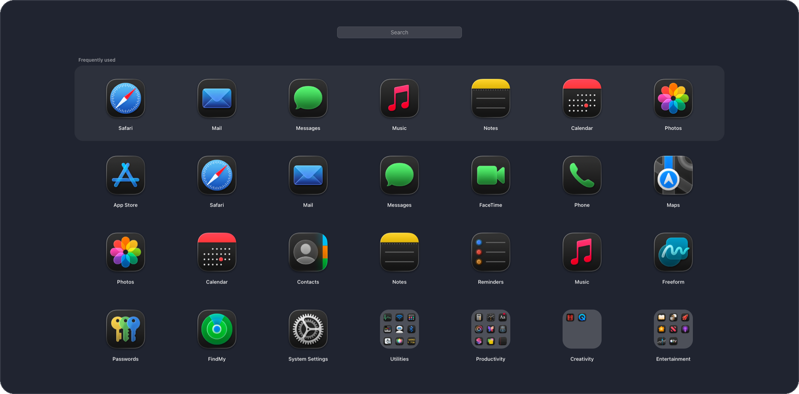
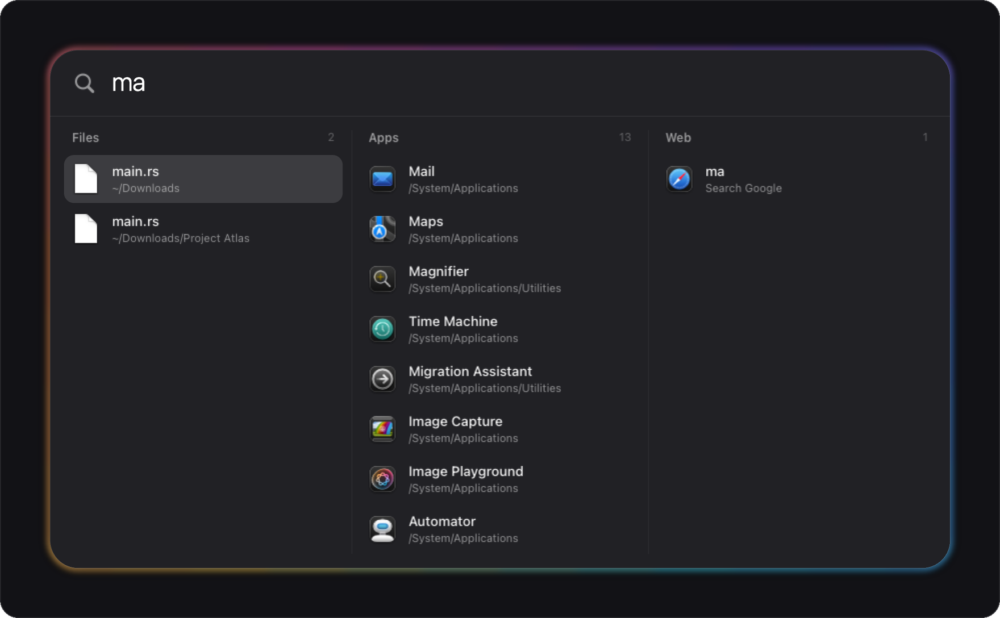
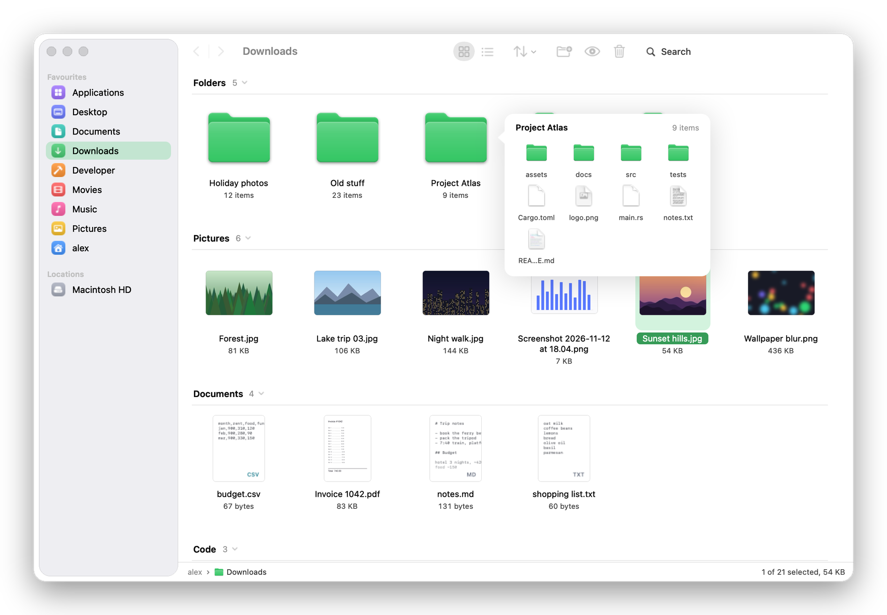

<div align="center">


# Liftoff

**Launchpad, Spotlight and Finder, rebuilt in Rust.**<br>
Because Apple is a fucking trillion dollar company that can't keep a launcher working.

[](../../releases/latest)


</div>

```sh
curl -fsSL https://raw.githubusercontent.com/Claude-Reverser/liftoff/main/install.sh | bash
```

Downloads the newest release, checks its checksum, puts it in `/Applications`, starts it at login and takes ⌘Space back from Spotlight. No sudo. Run it again to update.

<br>

## Launcher &nbsp;<kbd>⌥</kbd> <kbd>Space</kbd>



Launchpad, back the way it was before Apple swapped it for a Spotlight tab that forgets half your apps exist. Pages, folders, drag to rearrange, type to filter, and a frequently used row that counts every launch on the system. Apple's own apps get sorted into folders on first run.

## Search &nbsp;<kbd>⌘</kbd> <kbd>Space</kbd>



- **Files, Apps and Web** side by side. Whichever matched harder slides to the left
- its own file index, no mds: ~600k paths in about a second, ~8 ms a search, FSEvents keeps it current
- math right in the bar: `2^10`, `sqrt(2)*3`. Enter copies the answer
- <kbd>Tab</kbd> switches columns, <kbd>⌘</kbd><kbd>↩</kbd> opens the file in Files, <kbd>⌥</kbd><kbd>↩</kbd> copies the path

## Files &nbsp;<kbd>⌥</kbd> <kbd>⇧</kbd> <kbd>Space</kbd>



- grouped by what things are. The heading sticks while you scroll, click it to jump
- text and code files show their first lines, pictures and videos get real previews
- rest the pointer on a folder to see what's inside without opening it
- every place has its own colour and the folders in it match. Finder on a Graphite Mac is grey soup
- sort, filter, add or delete and things glide to where they belong instead of the window blinking

## Why it's fast

Raw AppKit and Core Animation from Rust through `objc2`. No Electron, no SwiftUI, no web view, one 1.3 MB binary. The app list is a `readdir` of the app folders every time it opens, under a millisecond, so it's never stale. Folders are read with `getattrlistbulk`, a whole directory in a couple of syscalls. Icons are rendered on every core at launch.

<details>
<summary><b>Installer options</b></summary>
<br>

Add them after `bash -s --`, e.g. `curl -fsSL … | bash -s -- --keep-spotlight`

| | |
|---|---|
| `--keep-spotlight` | leave ⌘Space to Spotlight |
| `--no-login` | don't start at login, just open it |
| `--version v0.3.0` | a specific release instead of the newest |
| `--force` | reinstall even if it's already that version |
| `--uninstall` | take it back out and give ⌘Space back. `--purge` also deletes your settings |

Hotkeys live in `~/Library/Application Support/Liftoff/`: `hotkeys`, `search-hotkeys`, `files-hotkeys`.

</details>

<details>
<summary><b>Build from source</b></summary>
<br>

Apple Silicon, macOS 14+, a Rust toolchain.

```sh
./install.sh --local
```

Builds this checkout and installs it exactly like a release. `scripts/make-dmg.sh` makes the release files. A local build gets its Dock icon copied off your own Mac, because shipping Apple's artwork in a repo that tells them to fuck off seemed like a bad idea.

</details>

<details>
<summary><b>Installing by hand</b></summary>
<br>

Grab the `.dmg` from [Releases](../../releases/latest) and drag Liftoff into Applications. It isn't notarized (not paying Apple $99 a year to tell them to fuck off), so open it once with right-click → Open, or run `xattr -dr com.apple.quarantine /Applications/Liftoff.app`. Then free ⌘Space under System Settings → Keyboard → Keyboard Shortcuts → Spotlight.

</details>

<br>

<sub>MIT. Do whatever. Just don't sell it back to Apple.</sub>
